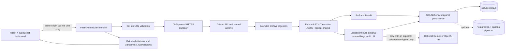

# RepoGuard AI

RepoGuard AI is a local-first analyzer for public GitHub projects. Each run is pinned to a resolved commit and combines Python plus JavaScript/TypeScript syntax structure, local Python static analysis, and evidence-grounded Q&A with optional embeddings and LLM generation.

It shortens the first-pass review of an unfamiliar codebase: inspect its layout and supported-language symbols, review local Ruff/Bandit output, and ask source-grounded questions whose answers link to analyzed lines.

## Architecture



The default workflow is local lexical retrieval on SQLite. PostgreSQL/pgvector and external model providers are optional and are not prerequisites for controlled fixture tests.

## Technology stack

- **Frontend:** React 19, TypeScript, Vite, React Router, Lucide icons, responsive CSS.
- **Backend:** Python 3.13, FastAPI, Pydantic Settings, SQLAlchemy, Alembic, HTTPX.
- **Code analysis:** Python AST, Tree-sitter JavaScript/TypeScript syntax extraction, Ruff, and Bandit. Ruff/Bandit currently analyze Python only; JavaScript/TypeScript coverage is reported as not analyzed instead of implying a clean scan.
- **Persistence and optional retrieval:** SQLite by default; PostgreSQL and pgvector are optional.
- **Quality:** pytest, Ruff, Prettier, TypeScript, Vite production build, GitHub Actions CI.

## Implemented features

- Accepts public GitHub repository URLs and rejects credentials, custom ports, malformed paths, and other hosts.
- Resolves the default branch to a full commit SHA; downloads that exact snapshot through `api.github.com` and a constrained `codeload.github.com` redirect.
- Pins each outbound TCP connection to a validated public IPv4/IPv6 DNS answer while retaining the original TLS SNI, certificate hostname check, and HTTP Host header. Environment proxies and connection reuse are disabled.
- Reads archive responses in bounded chunks, buffers at most the configured download limit, and applies entry-count, per-file, total accepted-file, chunk, and output bounds. It never executes repository code.
- Reports file/language statistics; extracts Python AST functions, classes, imports, and top-level assignments plus JavaScript/TypeScript functions, classes, methods, and imports with source ranges.
- Runs Ruff and Bandit against up to 100 Python files with subprocess timeouts; reports tool availability.
- Records when static-analysis coverage is truncated at that 100-file limit.
- Persists complete analysis snapshots/history using SQLite by default or PostgreSQL when configured.
- Provides file search and bounded source excerpts, filtered findings, lexical/semantic/hybrid Q&A with snapshot-validated citations, and Markdown/JSON exports.
- Includes optional OpenAI embeddings/chat and Gemini chat behind the existing provider interfaces. Without an API key, local Q&A ranks evidence from README/docs, dependency manifests, file paths, extracted symbols, source chunks, and saved findings. It attributes documentation statements, labels structural inferences, cites validated snapshot lines, and explains evidence gaps. This deterministic synthesis is evidence selection and templating, not a general-purpose local language model; it cannot reliably infer arbitrary runtime behavior.
- Includes a responsive React/TypeScript dashboard and FastAPI OpenAPI documentation.

### Verification status

| Capability | Status in this environment |
|---|---|
| Local API, dashboard, SQLite readiness | Verified over loopback |
| Controlled API fixture, symbols, Ruff finding, Q&A, citations, reports, reopen persistence | Verified by backend integration test |
| GitHub transport security behavior | Verified by mocked DNS and controlled local TLS regression tests |
| Live public GitHub analysis | Completed once under approved outbound access; current restricted shell cannot connect at pinned TCP |
| OpenAI embedding/chat request | Mock-tested only; no credential or live/billable call used |
| Gemini SDK generation | Mock-tested only; no Gemini key or live request used |
| PostgreSQL/pgvector | Query scoping mock-tested; no server/extension available |
| Docker Compose runtime | Unavailable; Docker engine pipe not present |

Controlled fixtures establish local workflow behavior. A separate approved run completed a live `pallets/itsdangerous` analysis, but the current shell and currently listening local backend cannot reach GitHub. This does not prove GitHub is reachable from the user's ordinary PowerShell process.

## Scope and limitations

- Analysis is synchronous. Redis/RQ jobs, progress polling, cancellation, and retries are not implemented.
- Python uses AST symbol extraction; JavaScript/TypeScript use Tree-sitter syntax extraction. Neither parser executes analyzed source. Other languages are classified by extension and chunked lexically. No JavaScript/TypeScript static-analysis engine is configured yet, and no complete call graph is produced. OpenAI embeddings/chat, Gemini generation, and PostgreSQL pgvector are optional; live model/database integrations are unverified.
- Set `RAG_PROVIDER=gemini` and `GEMINI_API_KEY` to opt into Gemini generation. `GEMINI_MODEL` defaults to `gemini-3.1-flash-lite`, listed as free tier for text input/output in Google's current pricing documentation. Free-tier quotas and model availability can change; no paid provider fallback is attempted. If the Google project has billing enabled, over-quota billing may still be possible according to Google's policy, so monitor usage and avoid enabling billing if you require a hard no-charge setup. Review the [RAG and privacy notes](docs/RAG_PIPELINE.md) first.
- `RAG_PROVIDER=auto` (default) selects Gemini when its key exists, otherwise OpenAI when its key exists, otherwise local mode. `RAG_PROVIDER=local` disables providers; `openai` and `gemini` explicitly select one. Gemini is generation-only and does not embed repository contents. OpenAI embeddings/chat remain as before when OpenAI is selected. Provider keys are read by the backend only and never returned to the frontend.
- PostgreSQL uses pgvector search when its extension is available. SQLite remains supported; it can compare stored vectors locally when embeddings exist and always retains the lexical fallback. The local PostgreSQL/pgvector path has not been tested against a running database in this environment.
- Findings are local Ruff/Bandit output. There is no AI remediation, authentication, or multi-user isolation; keep the service on a trusted local machine.
- Compose includes PostgreSQL with pgvector. Analysis snapshots remain JSON records; when embeddings are enabled, an optional pgvector side table supports semantic ranking. Docker runtime was unavailable during the earlier environment check.
- Compose published ports bind to `127.0.0.1`; the local development server commands also use loopback.
- GitHub API rate limits may apply. `GITHUB_TOKEN` is optional and must be set via the environment.

## Run locally

Requirements: Python 3.13+, Node.js 24+, npm. Docker is optional.

```powershell
python -m venv .venv
.\.venv\Scripts\python.exe -m pip install -r backend\requirements.txt
Set-Location backend
..\.venv\Scripts\python.exe -m uvicorn app.main:app --reload --host 127.0.0.1 --port 8001
```

The backend uses `backend/repoguard.db` SQLite when `DATABASE_URL` is unset. For local-only Q&A, leave both provider keys blank or set `RAG_PROVIDER=local`. To enable Gemini, create a backend-only environment file and set `GEMINI_API_KEY` there:

```powershell
Copy-Item .env.example backend\.env
notepad backend\.env
```

Keep `RAG_PROVIDER=gemini` (or `auto`). Source excerpts and the question are sent to Google only for Q&A generation; Gemini is not used for embeddings. The default `gemini-3.1-flash-lite` currently appears in Google's [model documentation](https://ai.google.dev/gemini-api/docs/models) and [free-tier pricing table](https://ai.google.dev/gemini-api/docs/pricing); availability and quotas can change. Free-tier content may be used to improve Google products. In another terminal:

```powershell
Set-Location frontend
npm.cmd ci
npm.cmd run dev -- --host 127.0.0.1 --port 5174 --strictPort
```

Open http://127.0.0.1:5174. API docs are at http://127.0.0.1:8001/docs. For optional file-based configuration, copy `.env.example` to `backend/.env`; never commit `.env`. The existing Vite configuration proxies same-origin `/api` requests to port 8001.

If either port is occupied, inspect it first with `Get-NetTCPConnection -State Listen -LocalPort 8001,5174 | Select-Object LocalAddress,LocalPort,OwningProcess` and `Get-Process -Id <PID>`. Do not start a duplicate or stop an unidentified process. If it is your old RepoGuard terminal, stop that server with Ctrl+C in its own terminal, then start the current checkout. Do not silently switch ports because the Vite API proxy is configured for port 8001.

### Controlled fixture demonstration

The deterministic fixture exercises the FastAPI workflow without GitHub access, API credentials, or writes to the normal application database. From the repository root:

```powershell
Set-Location backend
..\.venv\Scripts\python.exe -m pytest tests\test_fixture_workflow.py -q
```

It verifies a pinned example snapshot, file preview, symbol range, answerable and unanswerable Q&A, citations, Markdown/JSON reports, and persistence after reopening a temporary SQLite database. It does not fake successful live GitHub ingestion.

## PostgreSQL with Docker Compose

```powershell
docker compose up --build
```

Compose credentials are for local development only. Replace them before using a shared environment.

## API overview

| Method | Endpoint | Purpose |
|---|---|---|
| GET | `/api/health` | Process health |
| GET | `/api/readiness` | Database readiness |
| POST | `/api/analyses` | Analyze a public GitHub URL |
| GET | `/api/analyses` | Compact recent analysis history |
| GET | `/api/analyses/{id}` | Retrieve a snapshot |
| GET | `/api/analyses/{id}/files` | List/search file paths |
| GET | `/api/analyses/{id}/file-content?path=...` | Read bounded indexed excerpts for one manifest file |
| GET | `/api/analyses/{id}/findings` | Filter static findings |
| POST | `/api/analyses/{id}/ask` | Lexical/semantic/hybrid source Q&A with validated citations and honest provider/retrieval status |
| GET | `/api/analyses/{id}/report.md` | Markdown report |
| GET | `/api/analyses/{id}/report.json` | JSON report |

## Development checks

```powershell
Set-Location backend
..\.venv\Scripts\python.exe -m ruff check app tests
..\.venv\Scripts\python.exe -m pytest -q
Set-Location ..\frontend
npm.cmd exec -- prettier --check src
npm.cmd run build
```

The frontend has no configured lint script. CI runs the backend lint/test suite and frontend Prettier check/build. Repository scripts, tests, and binaries are never run by the analyzer.

Alembic migration verification is part of the backend suite and targets a new temporary SQLite database. Never point a test migration at a database containing user data.

## Screenshots

No verified browser screenshots are included yet. Capture these for a portfolio after a local browser review:

- `[Screenshot placeholder: workspace and recent analysis history]`
- `[Screenshot placeholder: repository overview, file tree, and findings]`
- `[Screenshot placeholder: Q&A answer and clickable source citation]`

## Runtime audit (2026-10-11)

- Verified local startup at `http://127.0.0.1:8000` and `http://127.0.0.1:5173/`; health, readiness, frontend page, and Vite's `/api/health` proxy returned HTTP 200.
- Backend tests (71) and Ruff passed; dependency consistency (`pip check`) passed. The 43 focused transport tests use a local TLS server and verify IPv4/IPv6 dial targets, TLS SNI/certificate hostname, Host header, denied DNS answers and redirects, proxy/pool behavior, timeouts, and response limits. Prettier check and the frontend TypeScript/Vite production build passed. The controlled fixture API workflow includes persisted SQLite readback and report/Q&A checks.
- Live `pallets/itsdangerous` analysis was attempted again through the application API but outbound connection to GitHub failed (`httpcore.ConnectError: All connection attempts failed`, returned as HTTP 502 by the local API). Live commit, manifest, and scanner results are therefore unverified.
- Docker engine was unavailable, so container startup was not tested. SQLite local mode was used.
- See [PROJECT_STATUS.md](PROJECT_STATUS.md) for commands, exact results, and remaining audit items. Connections are DNS-pinned and TLS-verified, but the unauthenticated application remains intended for trusted localhost use only.

## RAG milestone verification (2026-10-11)

- Backend suite: 89 tests passed with five upstream deprecation warnings; Ruff passed. Frontend Prettier and TypeScript/Vite production build passed.
- Provider behavior was tested with deterministic mock providers and mocked HTTP responses; no paid API call or live provider request was made. The PostgreSQL/pgvector SQL path was tested with mocked database results but not a running PostgreSQL server.
- Live GitHub ingestion remains unavailable because DNS resolves but pinned outbound TCP connections fail in this environment. Controlled fixtures do not substitute for a live repository run.
- See [docs/RAG_PIPELINE.md](docs/RAG_PIPELINE.md) for the optional provider setup, data-sharing behavior, bounds, fallbacks, and citation safeguards.

## Local integration verification (2026-10-11)

- Verified fallback configuration without opening or printing credentials: `OPENAI_API_KEY` and `DATABASE_URL` were absent from the process environment, and `backend/.env` did not exist. The configured default is local SQLite. No OpenAI API request was made.
- Backend and frontend were already listening on `127.0.0.1:8000` and `127.0.0.1:5173`. `GET /api/health`, `GET /api/readiness`, the Vite dashboard document, and the Vite `/api/health` proxy all returned HTTP 200. Starting duplicate processes failed because the ports were in use; an extra Vite process that selected 5174 was stopped.
- The controlled API fixture workflow passed, including answerable and insufficient-evidence Q&A, snapshot/commit citations, Markdown and JSON exports, and history restored from an isolated SQLite file after reopening the database. This test uses a deterministic in-process fixture and is not a live GitHub ingestion result.
- The Alembic baseline migration was applied and inspected in a new temporary SQLite database. The existing application database was not migrated, reset, or overwritten.
- Final checks: `..\\.venv\\Scripts\\python.exe -m pytest -q` passed (**92 tests**, six deprecation/configuration warnings); `..\\.venv\\Scripts\\python.exe -m ruff check app tests` passed; `npm.cmd exec -- prettier --check src` passed; `npm.cmd run build` passed TypeScript and Vite production build.
- Docker CLI was available but the daemon pipe was not; no containers were started. PostgreSQL/pgvector was not configured or connected, so only mocked pgvector query isolation and SQLite fallback were verified. OpenAI/provider behavior remains mock-tested only. Live GitHub remains blocked at pinned TCP as documented above.

### Repository Q&A update verification (2026-10-11)

- The current no-key path answers supported symbol-location, file line-count, and saved-finding questions using metadata from the selected snapshot. Unsupported interpretation returns explicit uncertainty and validated supporting locations when available; it does not turn retrieved source into answer prose.
- Earlier checks for the first answer-quality update: **120 backend tests passed** (five upstream warnings). The broader local synthesis update and its final results are recorded below in [Project status](PROJECT_STATUS.md).
- To deliberately opt in to external source processing, configure `OPENAI_API_KEY` in the backend environment or an untracked `backend/.env`, then restart the backend. This explicit configuration sends bounded source chunks and relevant excerpts/questions to OpenAI. Do not configure the key unless that sharing is intended.

## Final quality audit (2026-10-11)

- Fixed the workspace history view so API failures remain visible with a retry action instead of appearing as a successful empty workspace. Counts show unavailable/loading while history is not available.
- Frontend network failures now tell the user to check the local API; backend validation, repository, and GitHub connectivity responses retain their distinct messages.
- Unexpected analysis exceptions now log only their exception category; untrusted exception text and traceback are not written to application logs.
- ZIP symlink and special-file entries are explicitly skipped and reported. Static analyzer subprocess calls now specify `shell=False` explicitly.
- Final gates: **97 backend tests passed** with five upstream deprecation warnings; Ruff, `pip check`, frontend Prettier check, TypeScript validation, and Vite production build passed. `npm ls --depth=0` showed all declared frontend dependencies installed.
- The fixture workflow now runs Ruff/Bandit on a small controlled Python source and verifies the Ruff finding through the findings API, alongside files, symbols, Q&A, citations, reports, and SQLite persistence.
- No `pip-audit` installation was available, and no online advisory lookup was performed. These checks establish dependency consistency, not absence of known vulnerabilities.
- No browser component-test/lint script is configured. Frontend API errors are visually surfaced by the app; browser-level automated interaction remains a follow-up. Live GitHub/OpenAI/PostgreSQL and Docker status remains as in the table above.
- Live backend health/readiness/OpenAPI and Vite dashboard/proxy checks returned HTTP 200; a live unsupported-host submission returned HTTP 422. Browser automation was unavailable, so the UI was verified by build and HTTP/API smoke checks rather than a visual interaction session.

## GitHub ingestion diagnosis (2026-10-11)

- A sandbox request through `POST /api/analyses` resolved an allowed public IPv4 address for `api.github.com` but failed at the pinned TCP connect stage (`httpcore.ConnectError: All connection attempts failed`), before TLS. The API correctly returned HTTP 502 with a connectivity message.
- With approved outbound access, the same application route and secure pinned transport completed a live analysis of `pallets/itsdangerous` at commit `672971d66a2ef9f85151e53283113f33d642dabd`, including the validated GitHub 302 to codeload, archive download, and Markdown/JSON exports. This used an isolated temporary database and no external AI provider.
- These results show that ingestion works when the process can open outbound TCP. They do not confirm connectivity from the user's ordinary backend process; if its network context still blocks TCP, the UI will still show a connectivity error. See [PROJECT_STATUS.md](PROJECT_STATUS.md) and [SECURITY.md](SECURITY.md) for evidence and scope.
- Current verification: **105 backend tests passed** (five upstream deprecation warnings), focused transport tests **49 passed**, repository-wide Ruff passed, frontend Prettier passed, and TypeScript/Vite production build passed.

## Localhost readiness recheck (2026-10-11)

- Existing listeners: Python PID 20584 on 127.0.0.1:8000, Node PIDs 6200 on 5173 and 23320 on 5174. Health and readiness returned 200; both Vite `/api/health` proxy routes returned 200. Chrome rendered the dashboard at 5174 and reported an empty saved history. No process was stopped.
- Windows permitted executable/start-time inspection but denied WMI command-line inspection. The backend listener process started at 02:38 local, before the current backend source files' last-write timestamps around 11:xx. Therefore it is stale relative to disk unless an unobserved reload process replaced the code. Its command line and logs could not be read from this session. A real request to this listener for `https://github.com/pallets/itsdangerous` returned HTTP 502 and the connection error detail; it did not create a saved analysis.
- In the current command execution context, `curl.exe -I --connect-timeout 10` failed to connect to both `api.github.com:443` and `codeload.github.com:443`. The current source's pinned client resolved one allowed IPv4 address and failed during TCP connect (`httpx.ConnectError` / `httpcore.ConnectError: All connection attempts failed`) before TLS. This is consistent with outbound TCP restriction in this session. The user's separately observed curl 200/301 results were not reproducible here.
- Existing controlled transport tests verify DNS/IP pinning, TLS/SNI/hostname, redirect acceptance/rejection, response bounds, and archive safety. Bare repository URL, `.git`, and `www.github.com` forms now have explicit URL-parser regression coverage. No TLS, redirect, SSRF, or proxy protection was relaxed.
- Backend gates: **103 passed, 5 upstream warnings** before the added URL parameter case; `ruff check .` and `pip check` passed. Frontend Prettier, TypeScript/Vite build, and `npm ls --depth=0` passed. Re-run backend tests after this URL test change for final count.
- Browser verification was limited to rendering the dashboard and HTTP proxy checks. The available browser automation did not expose DevTools console output; no claim is made that console errors were inspected. No real browser submission was made from the current session. The backend API request was issued directly and failed at outbound connectivity.
- One separate approved egress-context integration run is recorded above: actual API analysis of `pallets/itsdangerous`, pinned commit `672971d66a2ef9f85151e53283113f33d642dabd`, and successful Markdown/JSON exports. It did not verify the user's ordinary local process context, live OpenAI, or a full live-repository Q&A in Chrome.

### Current PowerShell launch and acceptance commands

Backend terminal:

```powershell
Set-Location 'C:\Users\Hp\OneDrive\Desktop\RepoGuard AI — Intelligent GitHub Repository Analyzer\backend'
..\.venv\Scripts\python.exe -m uvicorn app.main:app --reload --host 127.0.0.1 --port 8001
```

Frontend terminal:

```powershell
Set-Location 'C:\Users\Hp\OneDrive\Desktop\RepoGuard AI — Intelligent GitHub Repository Analyzer\frontend'
npm.cmd run dev -- --host 127.0.0.1 --port 5174 --strictPort
```

Then open `http://127.0.0.1:5174`, check `http://127.0.0.1:8001/api/health` and `/api/readiness`, submit `https://github.com/pallets/itsdangerous` (no `.git` required), and verify the commit, files, findings, Q&A citations, reports, and history refresh. If submission fails, inspect the backend terminal from that same run; don't infer from a different shell's curl test.

## Architecture

- `backend/app/services/analyzer.py`: URL/host checks, archive safety, extraction, symbols, static tools, lexical retrieval.
- `backend/app/main.py`: HTTP endpoints, response validation, errors, reports.
- `backend/app/database.py`: SQLAlchemy persistence.
- `backend/migrations`: Alembic baseline migration.
- `frontend/src`: React dashboard and typed API client.

See [SECURITY.md](SECURITY.md), [CONTRIBUTING.md](CONTRIBUTING.md), and [PROJECT_STATUS.md](PROJECT_STATUS.md).
See [docs/RAG_PIPELINE.md](docs/RAG_PIPELINE.md) for provider setup, retrieval, storage, and privacy details.
See [docs/INTERVIEW_GUIDE.md](docs/INTERVIEW_GUIDE.md) for a code-grounded portfolio walkthrough and technical Q&A.

### Snapshot profile and evidence limits

Each analysis now stores a deterministic repository profile derived from its pinned file manifest, indexed text chunks, extracted Python/JavaScript/TypeScript symbols and imports, tool findings, and analyzer coverage. The profile labels statements as documented, observed, inferred, or tool-reported and carries source file/line references when available. The dashboard exposes this as **Project Overview** and **Recommended Improvements**; the Markdown and JSON reports include the persisted profile. Syntax-level import edges are not a runtime call graph. README statements remain documented claims until corroborated by implementation. API/database/security indicators are static pattern observations, not proof of complete or effective behavior.

Question retrieval now classifies common intents and weights symbols, implementation paths, manifests, findings, and docs accordingly. Generic docs and lockfiles are downweighted or excluded for implementation questions without topic evidence. Local generation remains deterministic lexical evidence synthesis; it is not semantic understanding. Optional OpenAI generation is used only when configured. Repository code is never executed.
